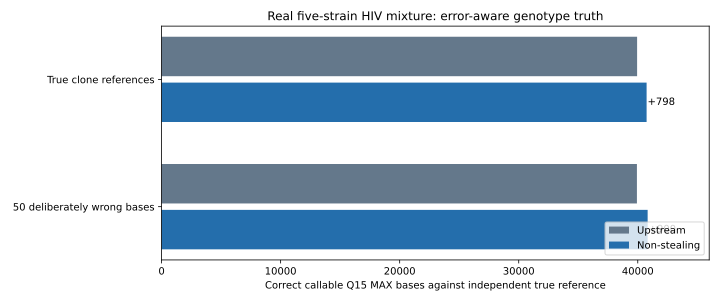

# Independent genotype and minority-haplotype validation

**Production decision: NO-GO. The PR is NOT ready for clinical production.**

## Independently established five-strain HIV truth

Published five-strain experimental HIV-1 mixture, Illumina MiSeq ENA accession **SRR961514**. Source-strain genomes were resequenced individually and reported in [Di Giallonardo / Töpfer et al. (NAR 2014)](https://github.com/cbg-ethz/5-virus-mix), doi:10.1093/nar/gku537. Of 714,994 original paired reads, a deterministic uniform sample of **59,770 original read pairs** was used. Five independent truth reference sequences contain **48,381 base positions**.

### Reference-matched control

- upstream: 39,944 correct; 0 wrong; 8,437 not callable; 173.9 seconds
- nonstealing: 40,742 correct; 0 wrong; 7,639 not callable; 447.7 seconds

The candidate gained **798 independently correct callable positions** with zero wrong calls observed in this test; its wall time was **448 seconds versus 174 seconds** upstream (~2.6x slower). It has not established statistically calibrated false-call bounds.

### Held-out, deliberately incorrect reference challenge

Fifty reproducible alternate nucleotides were planted in non-terminal positions across the five source contigs; the biological truth remained unchanged and independent. This controls for circular evaluation that simply rewards agreement with the mapping seed.

- upstream: 39,929 correct; 0 wrong; 8,452 not callable; 176.1 seconds
- nonstealing: 40,829 correct; 0 wrong; 7,552 not callable; 464.2 seconds

Upstream corrected **46/50** deliberately planted false bases (4 became uncallable, none retained false). The candidate corrected **47/50** with three uncallable and zero wrong callable seed bases; **900 extra correct callable bases** relative to upstream.

### Subsequent improved alignment-search experiment

A subsequent revised candidate with all reported Bowtie2 alignments and four ordered alignment threads recovered **40,772 correct** and **0 incorrect** bases in **199.8 seconds** on the same 59,770-pair HIV5 control. This is a separate, later run than the pinned eight-hit candidate reported above; it removes the finite eight-hit cutoff only for panels of at most 16 contigs. Larger panels remain bounded, and Bowtie2 still performs heuristic rather than exhaustive search.

## Nine Sanger-confirmed HIV minority haplotypes

Published nine-clone mixture, genotype proportions **50%, 25%, 12.5%, 6.3%, 3.2%, 1.6%, 0.8%, 0.4%, 0.2%**, 1,074 bases each, with [Sanger-verified reference haplotypes from the CliqueSNV validation dataset](https://github.com/Sergey-Knyazev/CliqueSNV-validation) (Knyazev et al., 2021, PMID 34214168). ENA run **SRR12042290** contains 2,783,356 pairs; deterministic subsample **239,006 pairs**.

- upstream: 7,751 correct; 15 wrong; 1,900 not callable; 1808.8 seconds
- nonstealing: 8,647 correct; 14 wrong; 1,005 not callable; 3243.1 seconds

| Clone | Truth-unique marker loci | Upstream correct | Candidate correct | Upstream wrong | Candidate wrong |
|:--|--:|--:|--:|--:|--:|
| A_50 | 0 | 0 | 0 | 0 | 0 |
| B_25 | 2 | 0 | 0 | 1 | 1 |
| C_12.5 | 0 | 0 | 0 | 0 | 0 |
| D_6.3 | 2 | 0 | 0 | 0 | 0 |
| E_3.2 | 2 | 0 | 0 | 1 | 1 |
| F_1.6 | 6 | 0 | 0 | 0 | 0 |
| G_0.8 | 4 | 0 | 0 | 0 | 0 |
| H_0.4 | 3 | 3 | 3 | 0 | 0 |
| J_0.2 | 3 | 3 | 3 | 0 | 0 |

### Alignment-independent linked private-SNP evidence

| Clone label | Private marker motifs | At least 1 exact motif | At least 2 linked motifs | At least 3 linked motifs |
|:--|--:|--:|--:|--:|
| A_50 | 0 | 0 | 0 | 0 |
| B_25 | 2 | 274 | 0 | 0 |
| C_12.5 | 0 | 0 | 0 | 0 |
| D_6.3 | 2 | 342 | 0 | 0 |
| E_3.2 | 2 | 117 | 0 | 0 |
| F_1.6 | 6 | 189 | 1 | 0 |
| G_0.8 | 4 | 142 | 3 | 1 |
| H_0.4 | 3 | 39,057 | 16,180 | 4,461 |
| J_0.2 | 3 | 96,433 | 35,122 | 6,536 |

These are exact, clone-specific 21-nucleotide motifs found directly in the original, unaligned paired FASTQ files; two or more matching motifs in one original pair provide true local sequence linkage, without using either MiCall mapper. They do NOT establish the complete haplotype sequence or unbiased clone abundance. The nominal clone labels in the published FASTA are NOT consistent with the observed motif prevalence: for example, the clone labelled J_0.2 has private motifs in 96,433 of 239,006 pairs, with two or more linked motifs in 35,122 pairs. H_0.4 has 39,057 and 16,180 pairs respectively. Until sample composition and amplification artifacts are independently reconciled, neither result can be described as demonstrated 0.2% or 0.4% abundance sensitivity.

**Interpreting this table:** a unique SNP detected at its correct reference position does not demonstrate recovery of a whole within-molecule haplotype, calibration of minority abundance, or complete phasing. The dominant A_50 and intermediate C_12.5 clones have no individual-only SNP allele in this alignment, so the marker analysis cannot separately identify them.

## Alignment search completeness: serious release blocker

The same 1,200 real HIV9 read pairs were aligned to nine individually verified plasmid references under Bowtie2 2.2.8 with a bounded 8-alignment reporting window versus a deeper '-a' search. **78 / 1,200 pairs** missed at least one reference found among the deeper search's best-scoring placements under the 8-hit cap. For the 1,117 structurally valid complete-pair groups, 46 had a different best-reference set: 42 with matching best score and four with a differing best score. At least one read had nine tied placements that cannot all be reported under an 8-hit cap.

On these same reads, changing Bowtie2's window to nine reduced missed-reference groups to **36**, and changing to sixteen left **32**; the latter discrepancies reflect more than the window size alone, including Bowtie2 heuristic search behavior. The '-a' search is a deeper *software search*, not independent biological truth. A finite Bowtie reporting window cannot certify that all compatible genotype hypotheses were discovered.

## Real HCV library-origin minority and absent-decoy challenges

An additional two-condition controlled experiment used actual unaltered read sequences from archived HCV libraries, retaining source-library identity in each read name. 50,000 HCV1a-labelled pairs were tested with zero versus 500 HCV2b-labelled pairs (0.9901% addition). A fixed third HCV1b-labelled contig was included but **zero source-library HCV1b reads** were added.

| Read-origin mix | Mapper | Real minor-origin read pairs correctly placed | Absent HCV1b-decoy mapped pairs from majority library | Decoy Q15 MAX callable bases |
|:--|:--|--:|--:|--:|
| HCV-origin-zero | upstream | 0 | 225 | 26 |
| HCV-origin-zero | nonstealing | 0 | 230 | 26 |
| HCV-origin-1pct | upstream | 428 | 225 | 32 |
| HCV-origin-1pct | nonstealing | 428 | 230 | 32 |

Both mappers placed **428 of 500** HCV2b-source pairs on the minor contig in the 0.99% mix and produced **173 callable Q15 MAX bases** for that minor contig. The absent HCV1b decoy nevertheless had **26 callable bases** in the no-minority run and **32** in the 0.99% mix under both mappers. **This false appearance was present upstream too**, not created by the non-stealing change. These labels are MiCall-inferred library genotype names, not independent LiPA-confirmed HCV truth. What is experimentally known is the *source of each read*.

## Confirmed bug and fix

The de novo selector rejected Bowtie2 primary pairs with exactly one mapped mate, even when upstream preserved those SAM rows. A real HCV negative control exposed **99 missing original read-pair records** (10,528 retained versus upstream 10,627). The change now preserves structurally valid primary singleton records, and cascade accounting counts **one mapped read end**, not a full two-end fragment, for each singleton. After the fix, both mappers retain the same **10,627** mapped original pair names. Existing MiCall sam2aln rejects any pair lacking two valid mate CIGARs, so these orphan records do *not* provide Q15 consensus bases; this is a compatibility and read-count bug, not 99 lost consensus molecules.

## Reproducibility and provenance

- Five-strain source FASTA is from the published repo's REF.fasta; ENA SRR961514 FASTQ MD5s f7e069e81ce706064e0112422950ac32 and 66012ec5036e8d3128c37e203fd006c5 were verified.
- Nine-plasmid Sanger truth is HIV9exp.fasta from the published validation repo; ENA SRR12042290 FASTQ MD5s f7a40ddbd8da7ce35aa0d4245043ea19 and bf229f9442e79f09e0a40924f19f5712 were verified.
- Baseline MiCall source commit cba1898a; independently known HIV5/HIV9 truth runs used original candidate source revision c6187fc57770c2a5c59cd4527dc05dcf40301f2f, before the singleton accounting fix. The HCV negative control was rerun after the singleton repair.
- Paired read IDs and original FASTQ, full variant alleles, original private cohort IDs, reference sequences, mapping logs and original data are kept in git-ignored .validation-work. Only aggregated evidence, tests and scripts appear in Git.
- Use prepare_truth_controls.py, prepare_hcv_origin_mix.py, real_hiv_hcv_20261106_runner.py, independent_truth_eval.py and hcv_origin_eval.py to reproduce, with private data access where relevant. No real clinical specimens are published.
- Generated 2026-11-07 19:23 UTC.

## Production readiness gates

| Gate | Result | Status |
|:--|:--|:--|
| Independently sequenced HIV base truth | +798 correct, zero wrong observed | Pass on this subset |
| Deliberately corrupted references | 47/50 corrected, 0 wrong observed, +900 true calls | Pass on this subset |
| Rare haplotypes to 0.2%, true phased abundance | Exact private-marker linkage found, but nominal clone labels disagree with observed read fractions | FAIL / unresolved truth |
| Competing mapping hypotheses | Revised <=16-contig search uses all Bowtie2-reported alignments; heuristic search and >16-contig cap remain | OPEN |
| Genotype absence specificity | Absent HCV1b decoy has apparent Q15 MAX bases | NOT ESTABLISHED |
| Runtime and memory budget | Revised HIV5 is ~200s vs 174s upstream; HIV9 and large panels need profiling | OPEN |
| Full clinical MiCall / G2P / trimming pathway | Not evaluated end-to-end on controls | OPEN |
| Singleton SAM / mapped-end accounting parity | Fixed and unit-tested | PASS |

**Release decision: NOT PRODUCTION READY.** Before clinical production deployment, the team must demonstrate reliable discovery of competing haplotypes, independent mixed-genotype specificity and minority frequency estimation, complete MiCall reporting, and acceptable repeatable resource consumption. Neither improved coverage nor zero observed errors on one control can substitute for these release gates.
