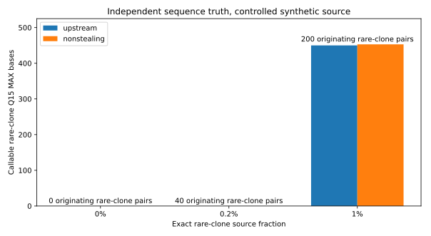

# Independently sequenced HIV9 clones: exact-source minority control

**Verdict: NO-GO for clinical production. This is an error-free synthetic control, not an independently measured biological mixture.**

## Study design

Nine independently Sanger-verified HIV clone sequences are used as genomic truth. 20,000 error-free 250 nt paired fragments from 450 nt inserts are generated using fixed random seeds. Clone9 has exactly 0, 40, or 200 originating read pairs for 0%, 0.2%, or 1% tests; clone1 is adjusted to maintain total depth. All other clone counts are held constant. Both MiCall arms use identical original FASTQ and fixed Sanger reference panels, verified by compressed-input and contig SHA-256. The generator RNG seeds are 4500 (0%), 4501 (0.2%) and 4502 (1%); the exact input mixture and seed are tracked in an ignored source manifest and in aggregate metrics.

The upstream source revision is cba1898a; the revised non-stealing mapping code is equivalent to local commit fad064abb503774103b9ac16f810c762285de97f. The original source FASTQ and contig checksums matched between each A/B pair; the challenge used Sanger-truth reference sequences as mapping seeds.

## Rare-clone source attribution versus consensus

| Minority source fraction | Original pairs | Mapper | Pairs correctly assigned | Exclusive correct pairs | Callable Q15 MAX bases | Wrong Q15 MAX bases | Wall seconds |
|:--|--:|:--|--:|--:|--:|--:|--:|
| 0% | 0 | upstream | 0 | 0 | 0 | 0 | 62.4 |
| 0% | 0 | nonstealing | 0 | 0 | 0 | 0 | 116.3 |
| 0.2% | 40 | upstream | 40 | 40 | 0 | 0 | 62.0 |
| 0.2% | 40 | nonstealing | 40 | 38 | 0 | 0 | 133.0 |
| 1% | 200 | upstream | 196 | 196 | 450 | 0 | 77.9 |
| 1% | 200 | nonstealing | 200 | 191 | 453 | 0 | 120.6 |

## Alignment-independent local marker linkage

Source-labeled clone9 private 21-mers were counted directly in the original unaligned read pairs, including their reverse complements. Multiple private markers on one sequenced pair demonstrate local linkage without relying on MiCall remapping. This cannot demonstrate full clone-length phase.

| Rare source fraction | One or more private markers | At least two linked | Three linked |
|:--|--:|--:|--:|
| 0% | 0 | 0 | 0 |
| 0.2% | 23 | 16 | 8 |
| 1% | 124 | 91 | 53 |

At a controlled 0.2% fraction, 16 original pairs link at least two of the three clone9-private markers and eight link all three, despite zero callable rare-clone consensus bases. At 0% no clone9-private pair markers were observed; at 1% 91 pairs link two or more. These are alignment-independent synthetic signals, not evidence of a validated biological detection limit.

## Full-panel truth concordance and correlated depth

| Rare clone fraction | Mapper | Correct Q15 MAX bases | Wrong Q15 MAX bases | True clone8 pairs | Callable clone8 bases |
|:--|:--|--:|--:|--:|--:|
| 0% | upstream | 6,866 | 0 | 80 | 556 |
| 0% | nonstealing | 6,885 | 0 | 80 | 567 |
| 0.2% | upstream | 6,742 | 0 | 80 | 555 |
| 0.2% | nonstealing | 6,765 | 0 | 80 | 570 |
| 1% | upstream | 7,289 | 0 | 80 | 559 |
| 1% | nonstealing | 7,320 | 0 | 80 | 571 |

## Conclusions and limitations

- No clone9 reads in the zero-minority control gave zero callable clone9 positions for either mapper. This is a favorable negative control only in the error-free simulation.
- With a true 0.2% fraction (40 read pairs), both implementations mapped all 40 pairs to clone9 but produced zero callable clone9 consensus bases under the 100x requirement.
- With 1% rare-clone origin (200 read pairs), the candidate recovered all 200 source pairs and 453 callable clone9 bases; upstream recovered 196 pairs and 450 callable bases.
- Across all three arms neither mapper produced any nucleotide disagreement with the matching Sanger references. Because those very references are used as contig seeds, this is not independent clinical variant adjudication.
- Clone8 has just 80 original source read pairs in every mixture yet more than 550 Q15 MAX callable bases. Compatible reads from other clones may support shared positions, so callable maximum-depth bases do not measure independent clone-specific molecules or full haplotype phase.
- This single constructed replicate per fraction cannot establish a clinical detection limit. There are no sequencing errors, PCR artifacts, primer bias, or independent measurements of a biological mixture. A 450 nt insert does not demonstrate full-length linkage of a 1074 nt clone.
- The real HCV read-origin dilution study separately shows source-pair mapping at 0.2% without any callable minority-contig position and apparent support on an absent reference. Large-panel real HIV reference loss remains.

Reproduction: the scripts known_hiv9_mixture_20261108.py, known_hiv9_mixture_eval_20261108.py and known_hiv9_mixture_report_20261108.py regenerate synthetic original pairs, independently verify their source labels, and summarize MiCall A/B outputs. Private FASTQ and per-read alignment files remain Git-ignored.

**Clinical production decision: NO-GO.**
