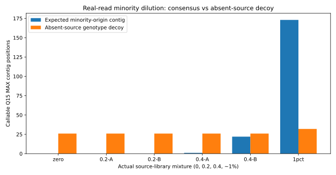

# Real HCV read-source minority dilution: 0%, 0.2%, 0.4%, 0.99%

**Interpretation: known source-library identity, not independently certified HCV genotype or full minority-haplotype truth.**

This experiment retains original unaltered reads from archived HCV libraries and resamples source-tagged, synchronized R1/R2 pairs. The same 50,000 majority-library pairs and fixed three-contig mapping panel are used throughout. Two distinct subsamples of 100 minority-library pairs and two of 200 minority-library pairs test empirical variability. The 500-pair control is inherited from the earlier experiment.

## A/B results

| Source-minority fraction | Arm | Known-origin pairs mapped to minority contig | Minority Q15 MAX callable positions | Absent-library decoy callable | Decoy fractional ≥100 | Runtime |
|:--|:--|--:|--:|--:|--:|--:|
| zero (0/50000) | upstream | 0/0 | 0 | 26 | N/A | 16.5s |
| zero (0/50000) | nonstealing-all-p4 | 0/0 | 0 | 26 | 26 | 12.3s |
| 0p2-A (100/50100) | upstream | 88/100 | 0 | 26 | N/A | 17.7s |
| 0p2-A (100/50100) | nonstealing | 88/100 | 0 | 26 | 26 | 8.5s |
| 0p2-B (100/50100) | upstream | 88/100 | 0 | 26 | N/A | 17.6s |
| 0p2-B (100/50100) | nonstealing | 88/100 | 0 | 26 | 26 | 8.9s |
| 0p4-A (200/50200) | upstream | 176/200 | 1 | 26 | N/A | 17.4s |
| 0p4-A (200/50200) | nonstealing | 176/200 | 1 | 26 | 26 | 8.2s |
| 0p4-B (200/50200) | upstream | 178/200 | 22 | 26 | N/A | 16.5s |
| 0p4-B (200/50200) | nonstealing | 178/200 | 22 | 26 | 26 | 8.1s |
| 1pct (500/50500) | upstream | 428/500 | 173 | 32 | N/A | 16.8s |
| 1pct (500/50500) | nonstealing-all-p4 | 428/500 | 173 | 32 | 32 | 12.3s |

## Interpretation and release implications

- At 0.2% measured read-source fraction (100 input minority pairs), both 0.2% subsamples mapped 88 minority-origin pairs correctly but produced **zero callable positions** in the minority contig. Under a 100× per-base minimum, this is expected when fewer than 100 usable original pairs support the entire contig.
- At 0.4%, two subsamples mapped 176/200 and 178/200 minority pairs correctly but yielded just **1 versus 22 callable positions**. This illustrates sequencing and coverage variance.
- At 0.99%, 428/500 minority-library source pairs mapped to the expected contig and 173 bases were callable in both arms.
- The absent-source HCV1b decoy was callable at 26 sites in the zero, 0.2% and 0.4% cases, and 32 sites in the 0.99% case. All decoy callable sites in the candidate met fractional 100× depth; average depth is **not** an adequate genotype-specificity filter in this control.
- The candidate preserved the same minority-contig callable counts and correctly paired minority-source counts as upstream across all cases. This shows no new *source-origin* regression here but does not prove clinical genotype specificity.
- The repeated subsamples share the same underlying archived libraries and are statistically correlated; do not pool their success counts as if they were independent biological specimens.
- No independent LiPA confirmation, molecular barcode abundance truth, full-length haplotype phasing, and complete clinical MiCall reporting was available. A genotype-presence decision must be tested on independently adjudicated negative controls.

## Reproducibility and provenance

The majority and minority libraries were selected from the protected 198-sample real FASTQ archive. The source pool contained 50,000 original HCV1a-labelled library pairs and 500 HCV2b-labelled library pairs with quality scores retained. Four conditions were created by synchronized whole-pair resampling and shuffling with deterministic seeds:

- 0.2% replicate A: 100 minority pairs, seed 1001.
- 0.2% replicate B: 100 minority pairs, seed 2002.
- 0.4% replicate A: 200 minority pairs, seed 3003.
- 0.4% replicate B: 200 minority pairs, seed 4004.

The script real_hcv_dilution_20261108.py produces the private resampled FASTQs. Every candidate/upstream A/B arm has matching compressed R1/R2 and fixed-contig SHA-256 fingerprints, verified by real_hcv_dilution_eval_20261108.py. Private sequence reads, original specimen identities and per-read mapping outputs are not tracked in Git.

Both MiCall branches ran map_to_contigs, sam2aln and aln2counts with Bowtie2 2.2.8; upstream source cba1898a, current candidate algorithm source ccb56a87. Candidate uses four alignment threads versus one upstream. The reported times were collected concurrently and cannot establish controlled performance equivalence.

The independent evaluator recounts both original mate streams, matches the source-library labels and distinguishes fully mapped R1/R2 pairs from names with only one mapped end. Five unit regressions test this distinction and the conservation of original reads and qualities.

**Production verdict: NO-GO.** These controlled real reads establish useful behavior but do not demonstrate sensitivity and specificity at 0.2% true biological haplotype abundance.
