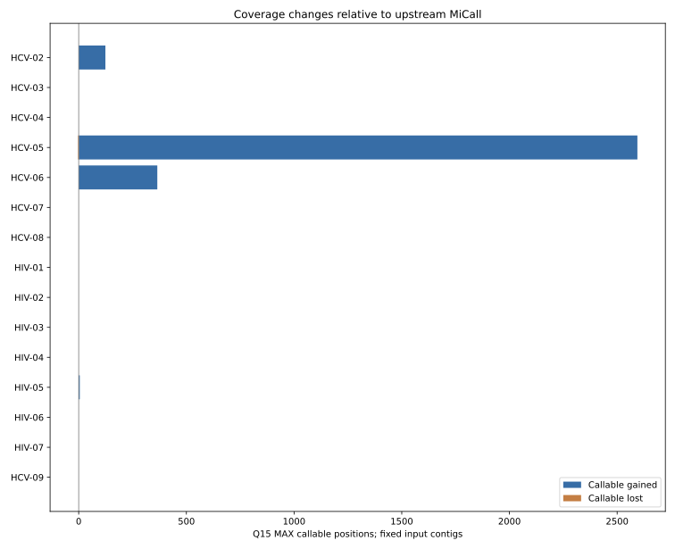

# Real HIV/HCV non-stealing remapper — executive validation

**Decision: promising experimental behavior, but NOT a clinical or production approval.**

**Dataset:** 15 of 16 completed controlled A/B conditions,
including 8 HCV-focused and 7 HIV-focused conditions.
The 16 selected conditions represent 14 unique archived specimens; two HCV
specimens were evaluated with both IVA and Ivanka contig panels.

## Findings at a glance

- **3,088 newly callable Q15 MAX positions; 3 lost; 1 callable-base disagreements.** These totals are case-condition coordinates, not statistically independent biological sites.
- Of the newly callable positions, **2,123** have candidate fractional depth below 100 despite maximum depth meeting that threshold; **965** also have fractional depth at least 100.
- **2,034** positions show lower maximum depth than upstream, even if some do not affect consensus calls.
- **143,005** additional mapping placements were reported; these are *alternative hypotheses*, not newly observed molecules.
- **Internal checks: PASS.** 0 depth-report disagreements and 0 unique-pair accounting mismatches in completed conditions.

## Selected outcomes

- HCV-05: +2,594 callable, -3 lost, 1 discordant; 1,882 newly callable sites with fractional depth <100.
- HCV-06: +365 callable, -0 lost, 0 discordant; 231 newly callable sites with fractional depth <100.
- HCV-02: +124 callable, -0 lost, 0 discordant; 7 newly callable sites with fractional depth <100.
- HIV-05: +5 callable, -0 lost, 0 discordant; 3 newly callable sites with fractional depth <100.

**Scientific caution — HCV-05:** For the preserved 16-contig Ivanka S48
panel, 2,594 Q15 MAX positions became callable, three were lost, and one
allele changed from T to C. Upstream Q15 observations were T=223/C=219;
non-stealing observations T=817/C=926. The supplied fixed contig carries
C, but is **not independent ground truth**. This illustrates the risk that
a new placement hypothesis can change a clinically relevant allele call.

## Scope and exceptions

- HCV-01: candidate completed, but upstream MiCall failed inside sam2aln on one malformed CSV row whose reference value was missing. This is not a valid paired A/B success.

Archived real paired-end FASTQ and fixed assembled contigs were used for
both arms. This is **not** full de novo reassembly, G2P, primer-trimming or
clinical report verification; no independently adjudicated genotype/variant
truth labels are available. The 16 conditions were purposively selected,
with some repeated specimens and many ambiguous contigs.

**Recommendation:** keep this PR experimental pending orthogonal variant
truth, haplotype/mixed-infection controls and controlled performance tests.

See the scientific report and anonymized machine-readable metrics.
Generated 2026-11-07 00:40 UTC.
