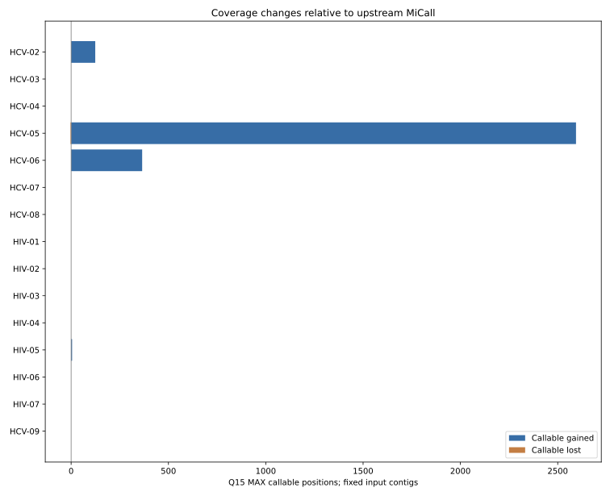
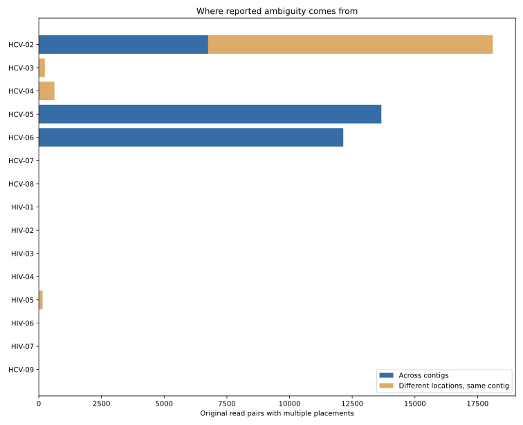
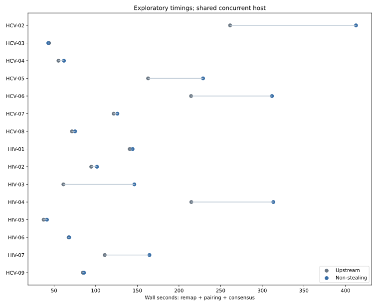

# Real HIV/HCV remapping — scientific and engineering report

## Research question

With genuine paired FASTQ inputs and **identical fixed contigs**, how does
a bounded equal-best multi-placement remapper alter MiCall coverage, consensus,
molecular accounting, and performance compared with the unmodified mapper?

## Versions, data, and experimental controls

- Upstream MiCall base commit: **cba1898a**.
- Non-stealing candidate commit: **2bc94b59366b0ff22a8a673bdb961c28ba75487a**.
- Python 3.12 and Bowtie2 2.2.8; same machine and installed dependencies.
- Archived private 198-sample dataset; **16 selected case-conditions from
  14 distinct samples**: 9 HCV-focused and 7 HIV-focused conditions.
  Two HCV specimens were run twice with *different* preserved contig panels.
  Some HIV V3-loop libraries include HLA-B contigs.
- Each arm receives byte-identical decompressed original paired FASTQ and the
  same archived original IVA or Ivanka contig CSV. SHA-256 of each compressed
  FASTQ and contig CSV was checked between arms.
- Pipeline boundary: MiCall map_to_contigs, sam2aln, aln2counts. Not an entire
  de novo assembly, primer trimming, G2P, or downstream clinical workflow.
- Candidate uses Bowtie2 -k 8 and retains complete, equal-best paired
  alignments. The maximum-depth interpretation supplies consensus; average
  (fractional) depth is diagnostic.
- Q15 MAX consensus is read from conseq.csv (q-cutoff 15, MAX cutoff).
  Callable means the base is A/C/G/T. All comparisons are coordinate-aware
  using contig reference ID and consensus offset. MiCall's established
  coverage threshold is 100.
- Upstream per-base coverage is reconstructed from Q15 aligned.csv using
  exact contiguous A/C/G/T runs. Candidate coverage is independently
  reconstructed the same way and cross-checked against max_depth from its
  sidecar. R1/R2 QNAME flags separately verify the physical sequenced
  input-pair count; PCR duplicates are **not** collapsed.

## Study results — one row per controlled input condition

| Case | Contigs from | Mapped references | Read pairs | Cross-contig alternatives | Callable delta | Base flips | Wall-time ratio |
|---|---:|---:|---:|---:|---:|---:|---:|
| HCV-02 | IVA | 3 | 45,738 | 6,755 | +124 | 0 | 1.58 |
| HCV-03 | IVA | 1 | 86,144 | 0 | +0 | 0 | 0.98 |
| HCV-04 | IVA | 1 | 26,496 | 0 | +0 | 0 | 1.12 |
| HCV-05 | Ivanka | 16 | 86,144 | 13,656 | +2,591 | 1 | 1.41 |
| HCV-06 | Ivanka | 15 | 26,496 | 12,143 | +365 | 0 | 1.45 |
| HCV-07 | IVA | 1 | 66,182 | 0 | +0 | 0 | 1.04 |
| HCV-08 | IVA | 3 | 83,281 | 0 | +0 | 0 | 1.05 |
| HIV-01 | IVA | 4 | 46,256 | 1 | +0 | 0 | 1.02 |
| HIV-02 | IVA | 3 | 35,995 | 2 | +0 | 0 | 1.07 |
| HIV-03 | IVA | 3 | 21,128 | 2 | +0 | 0 | 2.39 |
| HIV-04 | IVA | 3 | 67,450 | 4 | +0 | 0 | 1.46 |
| HIV-05 | IVA | 13 | 20,762 | 6 | +5 | 0 | 1.11 |
| HIV-06 | IVA | 2 | 25,292 | 0 | +0 | 0 | 1.01 |
| HIV-07 | IVA | 2 | 44,124 | 0 | +0 | 0 | 1.48 |
| HCV-09 | IVA | 1 | 81,537 | 0 | +0 | 0 | 1.02 |

## Aggregated results and integrity checks

- Valid paired conditions: **15/16**.
- Newly callable Q15 MAX case-condition positions: **3,088**.
  Lost callable positions: **3**.
  Directly conflicting base calls: **1**.
- Coverage decreased on **2,034** contig positions. These
  are not automatically consensus regressions, but require investigation.
- Site-level depth crossings at 100: 3,088 newly
  at or above 100; 2 fell below 100.
- Newly callable sites with fractional depth below 100: **2,123**;
  newly callable with fractional depth at least 100: **965**.
  These are *conditional* weights, not molecule-level probabilities.
- Additional alignments across completed conditions: **143,005**.
  Correlated placements do not increase the number of sequenced pairs.
- Independently recomputed maximum depth vs sidecar mismatches:
  **0**; unique paired-read accounting mismatches:
  **0**.

## Detailed HCV allele-discordance audit

For HCV-05 (S48, **16-contig archived Ivanka input**), the candidate gained
2,594 Q15 MAX callable positions and lost three, including one allele change
in contig 2-HCV-1a at the internal coordinate 1407:

| Evidence | T | C |
|---|---:|---:|
| Upstream, Q15 | 223 | 219 |
| Non-stealing, Q15 | 817 | 926 |

The candidate maximum depth at this position was **1,745**, while fractional
depth was approximately **639.47**. The input contig itself carried C.
That agreement is an internal consistency indication, **not independent
evidence of a true C allele**. The shift is highly relevant to clinical
minority-variant claims and cannot be signed off from coverage alone.

## Negative controls and unusual results

- Single-contig original IVA controls HCV-03 and HCV-04 retained identical
  Q15 MAX consensus. The candidate still added alternative alignments
  within repeated regions of the same contig, demonstrating that not all
  additional records represent *cross-contig* stealing recovery.
- The bound of eight equally best placements can truncate genuine ties.
  A contig with fewer than eight alternatives does not prove the candidate
  found every possible compatible alignment.
- **Upstream parser exception:** the HCV-01 upstream arm failed in sam2aln
  because a malformed SAM-derived CSV row had an absent reference field;
  the candidate arm completed. This is an upstream baseline failure, **not
  evidence of a comparative consensus benefit**, and is excluded from
  the paired totals. The malformed record is retained privately for audit.
- All successful A/B cases used identical input hashes. The candidate
  per-base max-depth output was independently reconstructed for validation.

## Performance and memory cautions

Time observations shown are elapsed seconds with up to seven A/B workers
sharing the same host. Contention, operating-system cache and workload
heterogeneity can dominate wall times; no meaningful p-value or
repeatability claim is possible. Additional alignments scale downstream
processing and CSV volume roughly with retained placements. The compact
sparse/packed depth accumulator limits memory overhead but does not remove
the compute/I/O cost of repeatedly considering a read.

A publication-quality runtime comparison requires serial randomized
replicates, controlled CPU affinity and memory profiling.

## Important limitations

1. **No independent biological truth.** Archived contigs and upstream
   MiCall calls are not validated patient genotypes; reference agreement
   or increased coverage cannot prove correctness.
2. **Fixed contig experiments.** These tests control remapping and consensus
   after assembly. They do not test upstream IVA/Ivanka assembly correctness.
3. **Nonrandom purposeful cohort.** Case-conditions are not independent
   specimens; no statistical extrapolation to 198 samples.
4. **Upper-bound semantics.** One read may count for multiple contig hypotheses.
   Maximum depth is not independent molecule depth; average depth is
   conditional on the bounded accepted placement set.
5. **No PCR/optical deduplication or phase truth.** QNAME-pair accounting
   corrects repeated alignment records, not true molecular duplication.
6. **Concurrent runtime tests.** Benchmark timings are descriptive only.
7. **MiCall version and workflow limitations.** A fixed Bowtie2 2.2.8 was
   used for A/B. The complete current production pipeline was not rerun.

## Reproducibility and privacy

Scripts beside this report are the repeatable runner, statistical analyzer,
position-level private diagnostics and report generator. The source data
come from the private archived real MiCall dataset; private alias-to-specimen
mapping, FASTQ/contigs, full per-base variant details, logs and SAM/CSV
intermediates are kept only in Git-ignored .validation-work/.
Tracked reports, charts and machine-readable cohort_metrics.csv use
**anonymous case labels** and aggregate numeric statistics only.

## Decision and follow-up

**Scientific verdict: experimental, not ready for clinical production.**
Observed improvements in remapping coverage are real as conditional
per-contig changes and have passed internal accounting checks, but the
same changes can alter MAX alleles and promote sites with fractional
depth below 100. Before merge for production use, obtain independently
genotyped controls, minority-haplotype spike-ins and known mixtures,
end-to-end full-MiCall validation, and repeated profiling.

Generated 2026-11-07 00:40 UTC.
